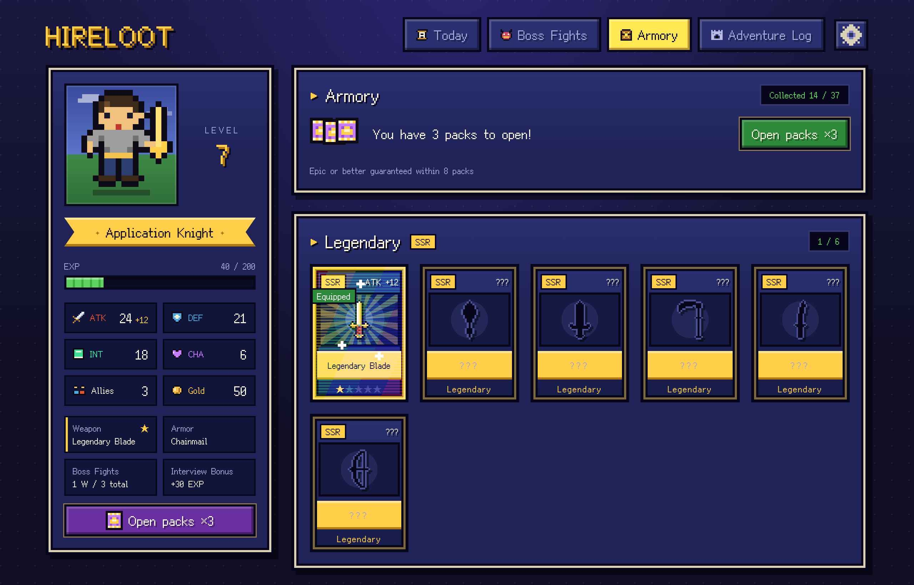

**A pixel-game-style to-do list that makes every job-hunting effort count.**

&nbsp;&nbsp;

 

> We know landing a job is hard.
> Hundreds of applications. Inboxes that stay quiet. Interviews that end with "we'll be in touch."
> **So what if we made the process a game?**

Hireloot is a pixel RPG to-do list for your job hunt. Every application, resume edit and coffee chat you finish turns into EXP, stats and gear. Every interview is a boss fight. Some days you win, some days you retreat, and either way your hero gets stronger.

You can't control when the offer comes. You can control showing up every day. Hireloot makes that part feel like progress.

## How to play

**1. Accept today's quests.** Write down what you plan to do today. A task starts as *Uncategorized*. If it counts as job-hunt effort, file it under Project, Resume, Applications, Networking or Interview Prep, and finishing it grows the matching stats and EXP.

**2. Check them off.** Rewards land right away. Anything you don't finish carries over to tomorrow, marked with how many days it's been waiting. No guilt, just a reminder.

**3. Fight bosses.** Log each interview with the company and round. Pass it and you earn +100 EXP and 50 gold. Fail it and you still walk away with +40 EXP, because every interview teaches you something. Don't know the result yet? Log it as *Pending* and settle it later.

**4. Level up, open packs.** Every level-up gives you 3 weapon packs. Tear one open to reveal a weapon: Common, Rare, Epic or Legendary, and the Epic and Legendary cards are holographic. The Armory holds all 37 weapons, and the ones you haven't found yet show only a black silhouette and "???". Duplicates add stars. Equip your favorite and your hero carries it.

**5. Look back.** The Adventure Log files every finished quest by day, so on the slow weeks you can see how much you've actually done.

## Start playing

No sign-up, no install, no server. (You can also host it online with cloud saves, see below.)

1. Download this repository (green **Code** button → **Download ZIP**), or `git clone` it.
2. Open `index.html` in your browser. That's it.

Bookmark the page and open it each morning.

The ⚙ button in the top right switches between English and 中文, and lets you export or import your save.

**By default your data stays on your computer.** Progress is saved in your browser's local storage and never leaves your device. That also means it lives in one browser on one computer, so export a save from Settings before switching browsers or clearing site data. To play across devices, turn on cloud saves as described below.

## Host it online: email sign-in and cloud saves

Hireloot can be hosted as a static site (for example on GitHub Pages), with [Supabase](https://supabase.com)'s free tier providing email and password sign-in and one cloud save per player. No backend code to write.

1. Create a project on Supabase.
2. Open the project's **SQL Editor**, paste in all of [`supabase/schema.sql`](supabase/schema.sql) and run it. It creates the `saves` table (one JSON save per user) and turns on row-level security, so each player can only read and write their own row.
3. Open **Project Settings → API** and copy the `Project URL` and the `anon public` key into [`config.js`](config.js). The anon key is meant to be public and is safe to commit. **Never put the `service_role` key there.**
4. Open **Authentication → URL Configuration**, set **Site URL** to your site's address (for example `https://your-name.github.io/hireloot/`) and add it to **Redirect URLs**. Links in confirmation and password-reset emails lead back there.
5. Deploy: in the repository go to **Settings → Pages**, pick the `main` branch root as the source, and save. The site is live a minute or two later.

Once it's on:

- The page opens with a sign-in window. Players can also choose to play as a guest, with the save kept on that device only. A guest save moves into the account the first time the player signs in.
- When signed in, every change uploads automatically. Offline changes are kept locally and uploaded once the connection is back. Settings shows the sync status.
- If two devices both changed the save, the game asks which one to keep instead of silently overwriting either.
- Signing out clears the save from that device. It stays in the cloud.
- Supabase's built-in email service only sends a few emails per hour. For real traffic, connect your own provider (such as Resend) under **Authentication → SMTP Settings**.

With `config.js` left empty, everything works exactly as before, fully local.

## For tinkerers

Hireloot is plain HTML, CSS and JavaScript with no build step. The one dependency, supabase-js, is vendored in `vendor/` and only loads when cloud saves are on.

| File | What's inside |
| --- | --- |
| `index.html` | Page structure |
| `style.css` | Pixel styling |
| `app.js` | Game logic. **All reward numbers, gear tiers and titles are at the top**, so tune them however you like. |
| `i18n.js` | Every piece of UI text, in Chinese and English. Add a language by adding a block here. |
| `weapons.js` | The Armory: weapon pixel art, palettes, rarities and drop rates. Add a weapon with one line. |
| `armory.js` | Pack-opening animation, holographic cards, 8-bit sound effects and the Armory page |
| `categorizer.js` | Suggests an effort type as you type. It uses keyword rules today. Replace `suggest(text)` to plug in an LLM. |
| `fonts/` | [Fusion Pixel](https://github.com/TakWolf/fusion-pixel-font) by TakWolf, under the SIL Open Font License (see `fonts/OFL.txt`) |
| `config.js` | Cloud save settings (Supabase URL and anon key). Leave empty for local-only. |
| `cloud.js` | Email sign-in, cloud sync and conflict handling |
| `supabase/schema.sql` | Database table and row-level security rules for cloud saves |
| `vendor/` | [supabase-js](https://github.com/supabase/supabase-js) 2.119.0, MIT license, loaded only when cloud saves are on |

To connect an LLM, have `suggest(text)` return one of `project`, `resume`, `apply`, `network`, `prep`, or `null`. The file has an example that calls a local endpoint. Don't put API keys in the page itself. Route requests through a small local server or a local model such as Ollama.

Issues and pull requests are welcome.

Good luck out there, hero. 🗡️
