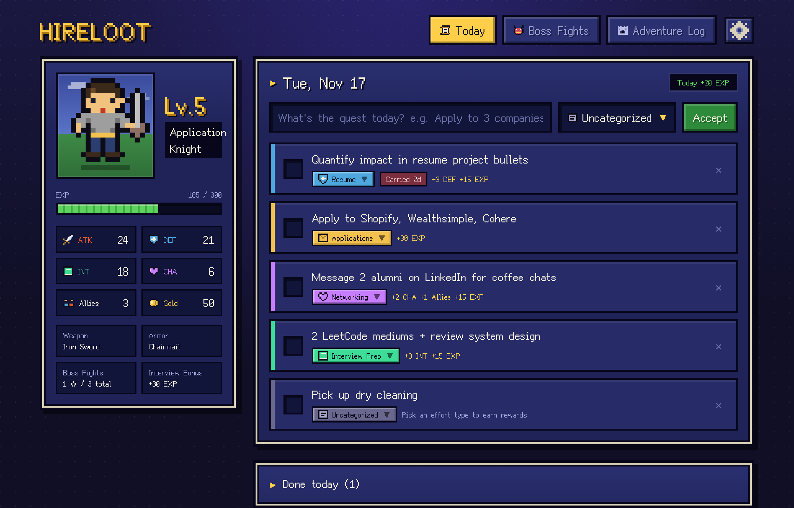
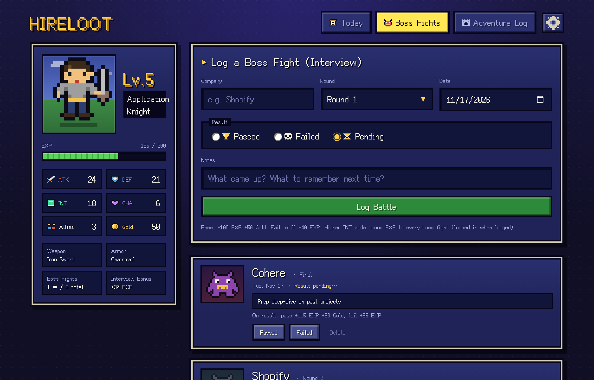
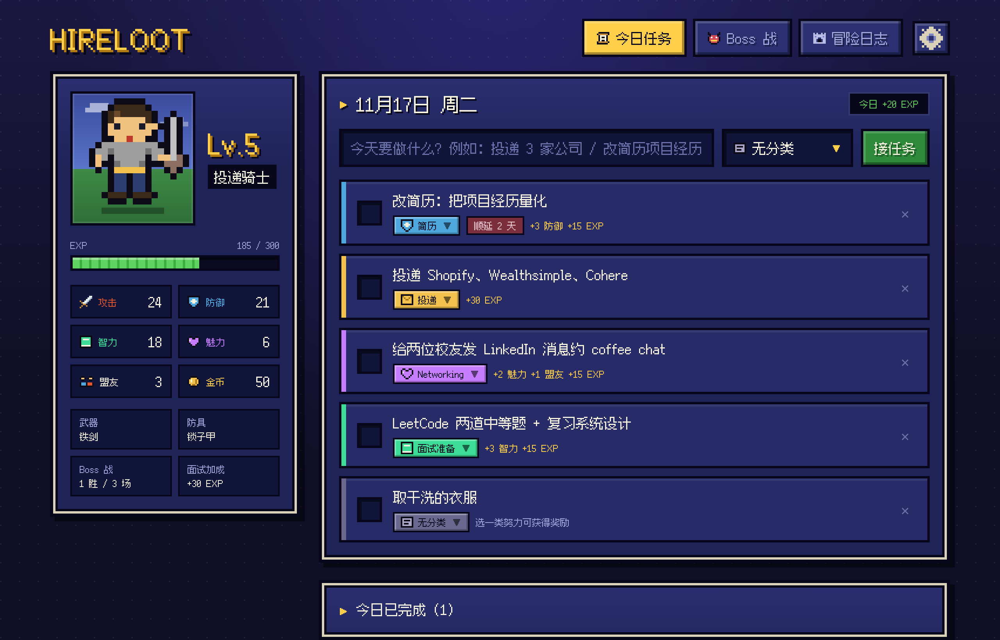
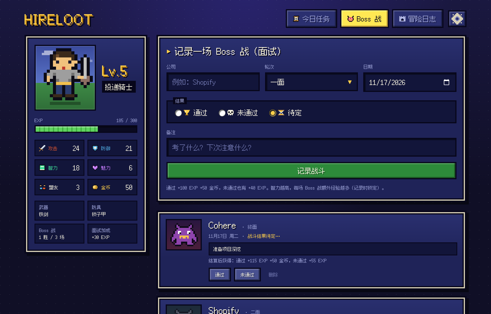

# HIRELOOT

**English** · [中文](#zh)

> We know landing a job is hard.
> Hundreds of applications. Inboxes that stay quiet. Interviews that end with "we'll be in touch."
> **So what if we made the process a game?**

Hireloot is a pixel RPG to-do list for your job hunt. Every application, resume edit and coffee chat you finish turns into EXP, stats and gear. Every interview is a boss fight. Some days you win, some days you retreat, and either way your hero gets stronger.

You can't control when the offer comes. You can control showing up every day. Hireloot makes that part feel like progress.

## How to play

**1. Accept today's quests.** Write down what you plan to do today. A task starts as *Uncategorized*. If it counts as job-hunt effort, file it under one of five types:

| Effort | Reward per quest | What it grows |
| --- | --- | --- |
| ⚔ Project | +3 ATK, +20 EXP | Your weapon: Bare Hands → Wooden Sword → … → Legendary Blade |
| 🛡 Resume | +3 DEF, +15 EXP | Your armor: Cloth → Leather → … → Dragon Scale |
| ✉ Applications | +30 EXP | The fastest way to level up |
| ❤ Networking | +2 CHA, +1 Ally, +15 EXP | Every conversation recruits an ally |
| 📖 Interview Prep | +3 INT, +15 EXP | Bonus EXP in every boss fight |

**2. Check them off.** Rewards land right away. Anything you don't finish carries over to tomorrow, marked with how many days it's been waiting. No guilt, just a reminder.

**3. Fight bosses.** Log each interview with the company and round. Pass it and you earn +100 EXP and 50 gold. Fail it and you still walk away with +40 EXP, because every interview teaches you something. Don't know the result yet? Log it as *Pending* and settle it later.

**4. Look back.** The Adventure Log files every finished quest by day, so on the slow weeks you can see how much you've actually done.

## Start playing

No sign-up, no install, no server.

1. Download this repository (green **Code** button → **Download ZIP**), or `git clone` it.
2. Open `index.html` in your browser. That's it.

Bookmark the page and open it each morning.

The ⚙ button in the top right switches between English and 中文, and lets you export or import your save.

**Your data stays on your computer.** Progress is saved in your browser's local storage and never leaves your device. That also means it lives in one browser on one computer, so export a save from Settings before switching browsers or clearing site data.

## For tinkerers

Hireloot is plain HTML, CSS and JavaScript. No build step, no dependencies.

| File | What's inside |
| --- | --- |
| `index.html` | Page structure |
| `style.css` | Pixel styling |
| `app.js` | Game logic. **All reward numbers, gear tiers and titles are at the top**, so tune them however you like. |
| `i18n.js` | Every piece of UI text, in Chinese and English. Add a language by adding a block here. |
| `categorizer.js` | Suggests an effort type as you type. It uses keyword rules today. Replace `suggest(text)` to plug in an LLM. |
| `fonts/` | [Fusion Pixel](https://github.com/TakWolf/fusion-pixel-font) by TakWolf, under the SIL Open Font License (see `fonts/OFL.txt`) |

To connect an LLM, have `suggest(text)` return one of `project`, `resume`, `apply`, `network`, `prep`, or `null`. The file has an example that calls a local endpoint. Don't put API keys in the page itself. Route requests through a small local server or a local model such as Ollama.

Issues and pull requests are welcome.

Good luck out there, hero. 🗡️

---

# HIRELOOT

[English](#en) · **中文**

> 找工作有多难，我们都知道。
> 投了几百份简历，邮箱一片安静；面完试，等来一句「我们会再联系你」。
> **那如果，把找工作变成一场游戏呢？**

Hireloot 是一个像素 RPG 风格的求职待办清单。你每投一份简历、改一版简历、约一次 coffee chat，都会变成经验值、属性和装备。每一场面试都是一场 Boss 战。有时赢，有时撤退，但无论哪种，你的勇者都在变强。

Offer 什么时候来，你决定不了。但每天坚持出现，你可以。Hireloot 让这件事看得见、有进度。

## 怎么玩

**1. 接下今天的任务。** 写下今天要做的事。任务默认是「无分类」；如果它算求职上的努力，就归到五类之一：

| 努力 | 每完成一项 | 成长 |
| --- | --- | --- |
| ⚔ 项目 | +3 攻击，+20 EXP | 武器：赤手空拳 → 木剑 → … → 传说圣剑 |
| 🛡 简历 | +3 防御，+15 EXP | 防具：布衣 → 皮甲 → … → 龙鳞甲 |
| ✉ 投递 | +30 EXP | 升级最快的方式 |
| ❤ Networking | +2 魅力，+1 盟友，+15 EXP | 每次交流都结识一位盟友 |
| 📖 面试准备 | +3 智力，+15 EXP | 每场 Boss 战额外加经验 |

**2. 勾掉完成的任务。** 奖励马上到账。今天没做完的会自动顺延到明天，并标出拖了几天。不用自责，只是提醒。

**3. 打 Boss。** 每场面试记一笔：公司和轮次。通过拿 +100 EXP 和 50 金币；没过也有 +40 EXP，因为每一场面试都会让你学到东西。结果还没出？先记「待定」，出结果再结算。

**4. 回头看看。** 冒险日志按天归档每一个完成的任务。在没有进展的那几周，你能看到自己其实做了多少。

## 开始游戏

不用注册，不用安装，也没有服务器。

1. 下载这个仓库（绿色 **Code** 按钮 → **Download ZIP**），或者 `git clone`。
2. 用浏览器打开 `index.html`，就可以开始了。

建议加个书签，每天早上打开。

右上角的 ⚙ 按钮可以切换中文 / English，也可以导出、导入存档。

**数据只存在你自己的电脑上。** 进度保存在浏览器的本地存储里，不会上传到任何地方。也正因如此，它只在这台电脑的这个浏览器里有效。换浏览器或清除网站数据前，记得先在设置里导出存档。

## 想自己改？

Hireloot 只用了原生 HTML、CSS 和 JavaScript，没有构建步骤，也没有依赖。

| 文件 | 内容 |
| --- | --- |
| `index.html` | 页面结构 |
| `style.css` | 像素风样式 |
| `app.js` | 游戏逻辑。**奖励数值、装备档位和称号都在文件最上面**，随便调。 |
| `i18n.js` | 所有界面文字（中文和英文）。想加一种语言，在这里加一段就行。 |
| `categorizer.js` | 打字时建议分类，目前是关键词规则。改写 `suggest(text)` 就能接入 LLM。 |
| `fonts/` | TakWolf 的 [Fusion Pixel](https://github.com/TakWolf/fusion-pixel-font) 像素字体，SIL 开源字体许可（见 `fonts/OFL.txt`） |

接 LLM 时，让 `suggest(text)` 返回 `project`、`resume`、`apply`、`network`、`prep` 之一，或者 `null`。文件里有调用本地接口的示例。不要把 API Key 直接写进网页，建议通过本地小服务或者 Ollama 这类本地模型转发。

欢迎提 Issue 和 PR。

祝你早日上岸，勇者。🗡️
