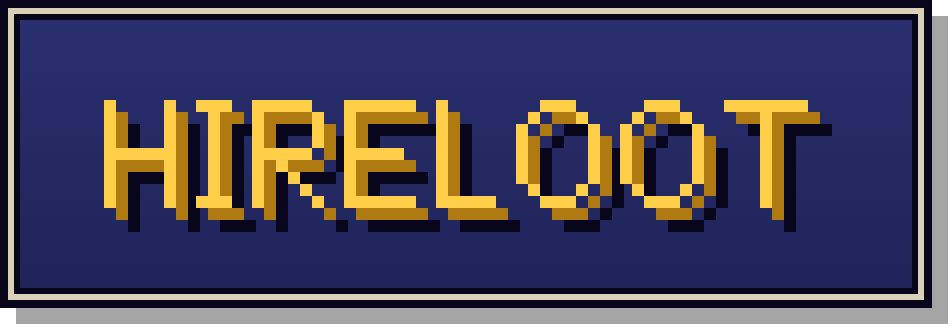
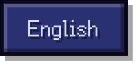
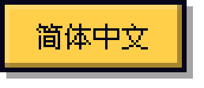
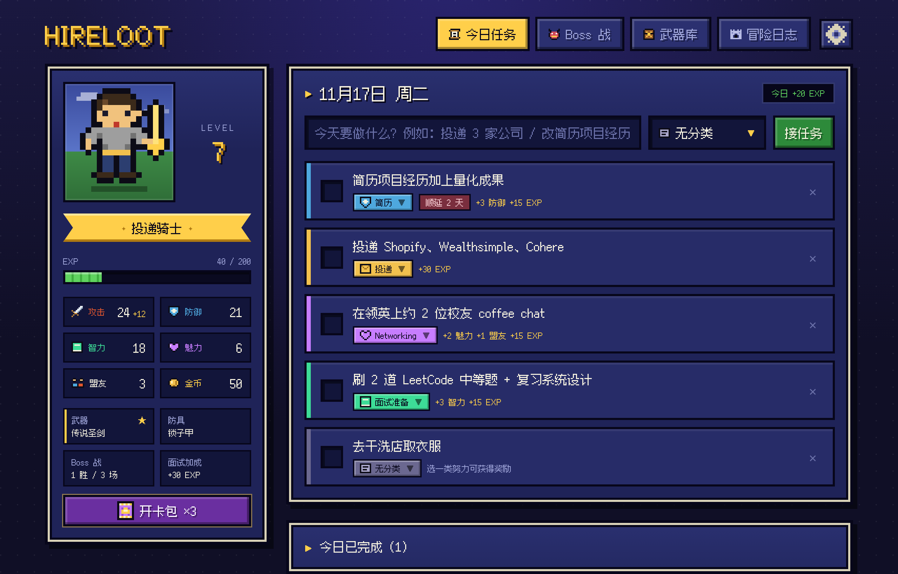
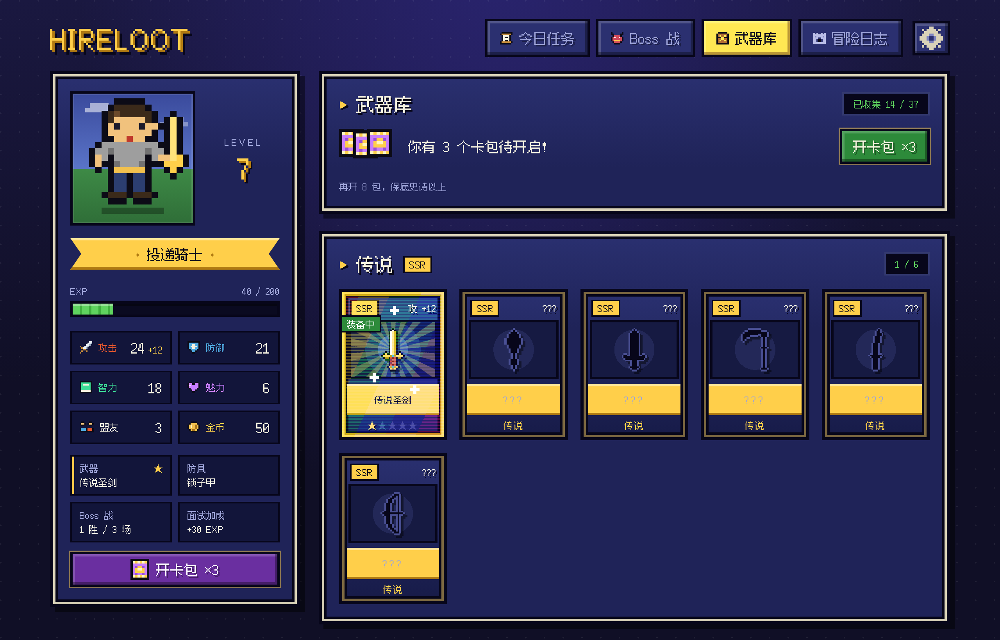
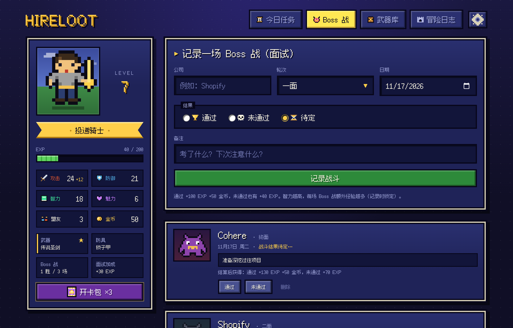

**一个像素游戏风格的待办清单，让找工作的每一份努力都算数。**

&nbsp;&nbsp;

 

> 找工作有多难，我们都知道。
> 投了几百份简历，邮箱一片安静；面完试，等来一句「我们会再联系你」。
> **那如果，把找工作变成一场游戏呢？**

Hireloot 是一个像素 RPG 风格的求职待办清单。你每投一份简历、改一版简历、约一次 coffee chat，都会变成经验值、属性和装备。每一场面试都是一场 Boss 战。有时赢，有时撤退，但无论哪种，你的勇者都在变强。

Offer 什么时候来，你决定不了。但每天坚持出现，你可以。Hireloot 让这件事看得见、有进度。

## 怎么玩

**1. 接下今天的任务。** 写下今天要做的事。任务默认是「无分类」；如果它算求职上的努力，就归到项目、简历、投递、Networking、面试准备这五类之一，完成后就会涨对应的属性和经验。

**2. 勾掉完成的任务。** 奖励马上到账。今天没做完的会自动顺延到明天，并标出拖了几天。不用自责，只是提醒。

**3. 打 Boss。** 每场面试记一笔：公司和轮次。通过拿 +100 EXP 和 50 金币；没过也有 +40 EXP，因为每一场面试都会让你学到东西。结果还没出？先记「待定」，出结果再结算。

**4. 升级开卡包。** 每升一级送 3 个武器卡包。撕开卡包会翻出一把武器，分普通、稀有、史诗、传说四档，史诗和传说是镭射卡。武器库里收着全部 37 把武器，没抽到的只显示黑色剪影和「???」。抽到重复的武器会升星，挑一把装备上，角色手里的武器就换成它。

**5. 回头看看。** 冒险日志按天归档每一个完成的任务。在没有进展的那几周，你能看到自己其实做了多少。

## 开始游戏

不用注册，不用安装，也没有服务器。

1. 下载这个仓库（绿色 **Code** 按钮 → **Download ZIP**），或者 `git clone`。
2. 用浏览器打开 `index.html`，就可以开始了。

建议加个书签，每天早上打开。

右上角的 ⚙ 按钮可以切换中文 / English，也可以导出、导入存档。

**数据只存在你自己的电脑上。** 进度保存在浏览器的本地存储里，不会上传到任何地方。也正因如此，它只在这台电脑的这个浏览器里有效。换浏览器或清除网站数据前，记得先在设置里导出存档。

## 想自己改？

Hireloot 只用了原生 HTML、CSS 和 JavaScript，没有构建步骤，也没有依赖。

| 文件 | 内容 |
| --- | --- |
| `index.html` | 页面结构 |
| `style.css` | 像素风样式 |
| `app.js` | 游戏逻辑。**奖励数值、装备档位和称号都在文件最上面**，随便调。 |
| `i18n.js` | 所有界面文字（中文和英文）。想加一种语言，在这里加一段就行。 |
| `weapons.js` | 武器库：武器像素造型、配色、稀有度和抽卡概率。加武器只要加一行。 |
| `armory.js` | 开卡包动画、镭射卡面、8-bit 音效和武器库页面 |
| `categorizer.js` | 打字时建议分类，目前是关键词规则。改写 `suggest(text)` 就能接入 LLM。 |
| `fonts/` | TakWolf 的 [Fusion Pixel](https://github.com/TakWolf/fusion-pixel-font) 像素字体，SIL 开源字体许可（见 `fonts/OFL.txt`） |

接 LLM 时，让 `suggest(text)` 返回 `project`、`resume`、`apply`、`network`、`prep` 之一，或者 `null`。文件里有调用本地接口的示例。不要把 API Key 直接写进网页，建议通过本地小服务或者 Ollama 这类本地模型转发。

欢迎提 Issue 和 PR。

祝你早日上岸，勇者。🗡️
